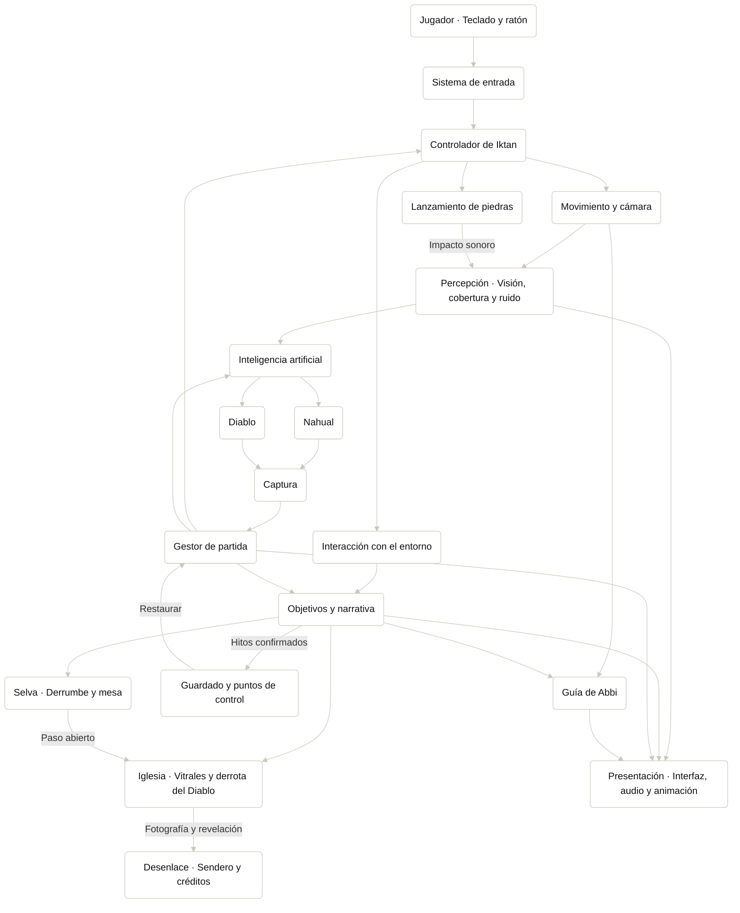

# Arquitectura Técnica

## Descripción de la sección

Explica cómo está construido técnicamente el videojuego y cómo se comunican sus componentes.

## Arquitectura

```text
Entrada
  ↓
Controlador
  ↓
Lógica de juego
  ↓
Sistemas
  ↓
Datos / Persistencia
  ↓
Presentación
```

## Componentes principales

| Componente | Responsabilidad | Dependencias |
|---|---|---|
| Sistema de entrada y controlador de Iktan | Traducir teclado y ratón en movimiento, postura, cámara, lanzamiento e interacción. | Configuración y estado de partida. |
| Lanzamiento de piedras | Prever la trayectoria, resolver el impacto y emitir el evento sonoro. | Entrada y colisiones. |
| Percepción e IA | Evaluar cobertura, sonidos y haces, y decidir la respuesta del Nahual y del Diablo. | Posición de Iktan, geometría y eventos de impacto. |
| Guía de Abbi | Seguir a Iktan y señalar rutas o peligros mediante gestos. | Posición de Iktan y objetivo actual. |
| Entorno y objetivos | Resolver la columna, la mesa, los vitrales y la fotografía. | Interacción, estado de las amenazas y progresión. |
| Gestor de partida | Coordinar pausa, captura, transición de nivel, reinicio y desenlace. | Objetivos y servicio de guardado. |
| Persistencia | Registrar hitos confirmados y restaurar puntos de control. | Datos de progreso y preferencias. |
| Presentación | Mostrar interfaz, animaciones, efectos y audio según el estado del juego. | Eventos de la partida y datos visibles. |

## Comunicación

Los componentes locales se comunican mediante referencias explícitas. Los cambios que afectan a varios sistemas se publican como eventos. Por ejemplo, al impactar una piedra, el lanzamiento emite un evento con la posición y el radio sonoro. La percepción comprueba si la amenaza puede oírlo y la IA decide si cambia su orientación o recorrido. Los pasos pueden alertar, pero las piedras son la única distracción intencional.
 
El sistema de objetivos confirma cada interacción una sola vez. El último vitral desactiva al Diablo y hace aparecer el altar. Tomar la fotografía activa la revelación y, al concluir, se habilita el sendero. El guardado recibe estos hitos y la interfaz presenta los objetivos confirmados.

### Diagrama de componentes



## Principios técnicos

- Bajo acoplamiento cuando sea razonable.
- Responsabilidades claras.
- Código mantenible.
- Datos separados de lógica cuando corresponda.
- Evitar dependencias innecesarias.


> **Navegación:** [[00 - Índice]] · ← [[04 - Guardado y Configuración]] · [[02 - Motor y Herramientas]] →
